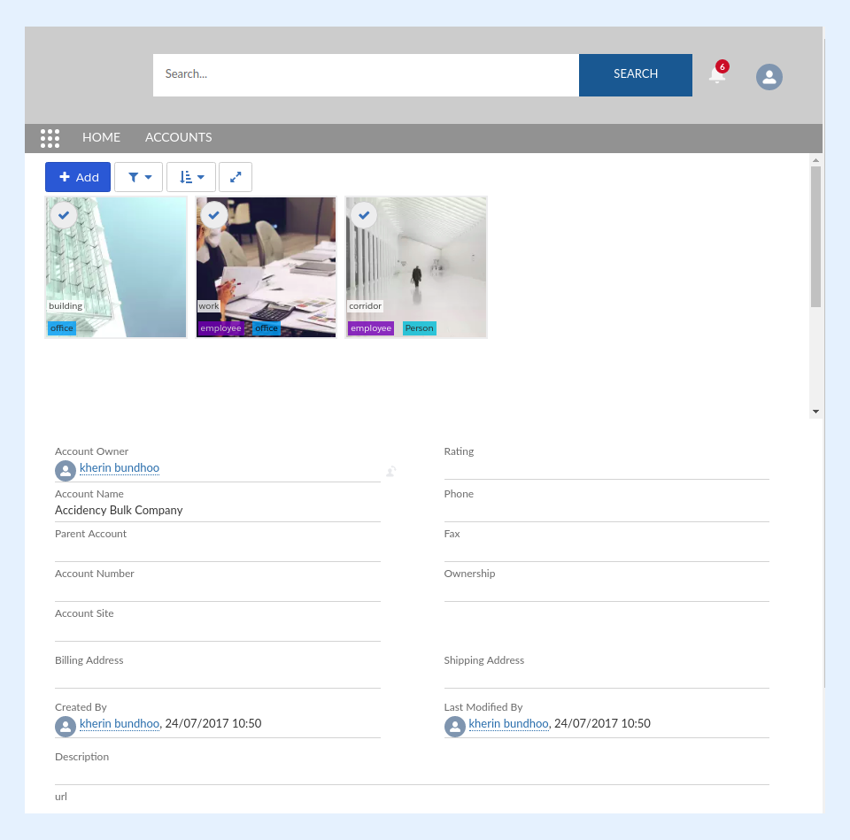

---
layout:
  width: default
  title:
    visible: true
  description:
    visible: true
  tableOfContents:
    visible: true
  outline:
    visible: true
  pagination:
    visible: true
  metadata:
    visible: false
  tags:
    visible: true
  actions:
    visible: true
  anchors:
    visible: true
---

# View / Upload Pictures on Salesforce Community

Most of the SharinPix Lightning components are available on Salesforce Communities.

You can simply add them to the Community Page Builder just like to the Record Page Builder.

**Best Practice is to test the community experience with a non-admin profile as SharinPix usage on Community requires the assignment of SharinPix Licenses and specific** [**SharinPix Permission set**](https://app.gitbook.com/s/5EvYRrLbUyvRh8o1jmMG/access-and-security/sharinpix-community-users-access-rights)**.**

Furthermore, do not hesitate to check the [Overview of the SharinPix Lightning Components](https://app.gitbook.com/s/5EvYRrLbUyvRh8o1jmMG/lightning-web-component/overview-of-the-sharinpix-lightning-components) article, and visit the component description to check if a component is accessible in a Salesforce Community if you want to add the same in a Community.

.png>)
