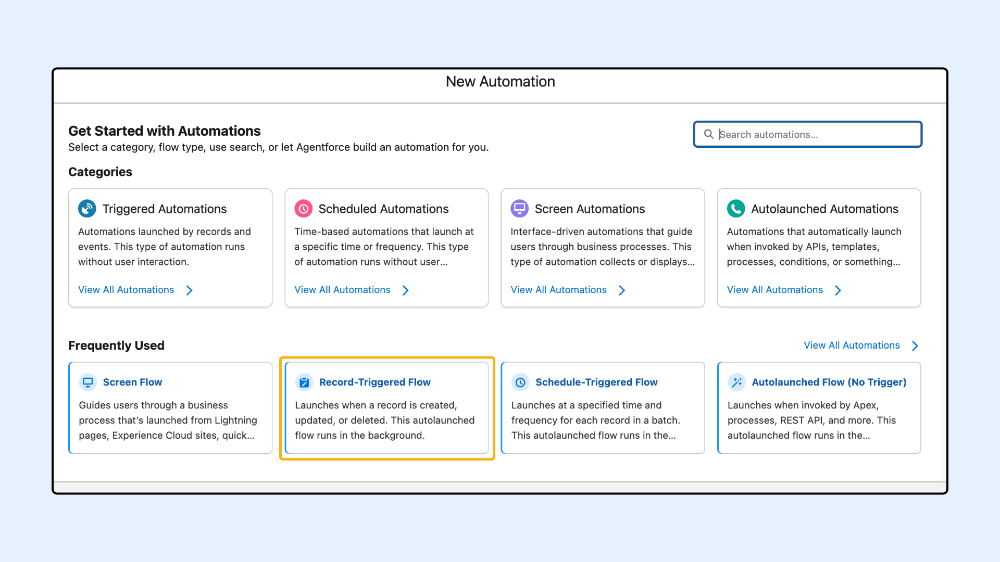
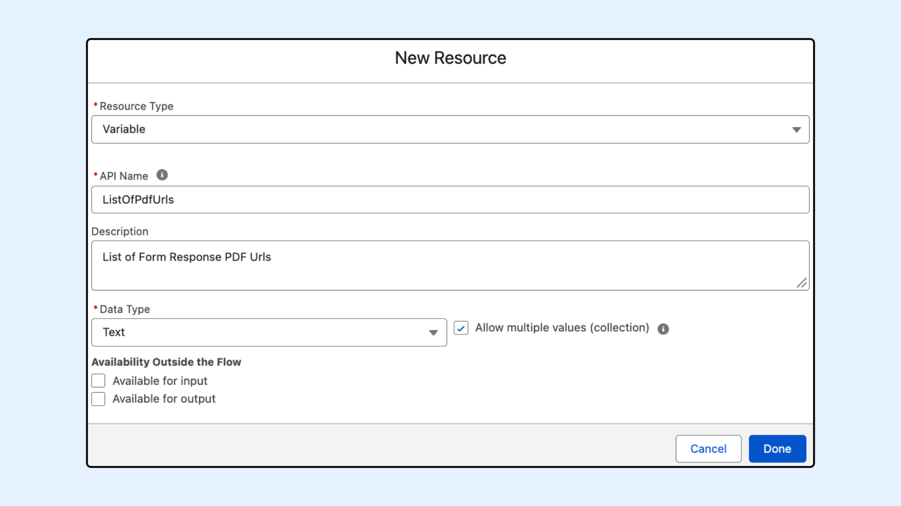

# Merge multiple PDF URLs into a single merged PDF URL

## Overview&#x20;

This article demonstrates how to use the SharinPix <mark style="color:$danger;">`mergePdfUrls`</mark> Apex method and the <mark style="color:$danger;">`MergePdfUrlAutomation`</mark> invocable action to combine multiple PDF URLs into a single merged PDF URL. You can use this feature in Salesforce Flows and custom Apex code.&#x20;


**Prerequisites**

Before implementing it, ensure your Salesforce environment meets the following requirements:

* **Package Version:** Ensure you have the **SharinPix Package version 1.415 or newer** installed. Follow this [guide](https://docs.sharinpix.com/faqs/how-to-update-sharinpix-package-from-the-appexchange) to upgrade your SharinPix Managed Package to the latest version.
* **Permissions:** Users must have the **SharinPix Lightning Components** permission set assigned. For more information on permission sets, check [SharinPix Permission Sets](https://docs.sharinpix.com/documentation/access-and-security/sharinpix-permission-sets).


## Automatically Merging PDF URLs Using Salesforce Flow (Admin-Oriented)

The <mark style="color:$danger;">`MergePdfUrlAutomation`</mark> is an Apex Action designed to merge multiple PDF URLs into a single URL. In the following sections, we will demonstrate how to implement this action within [a Salesforce Flow](merge-multiple-pdf-urls-into-a-single-merged-pdf-url.md#configuring-the-flow-to-merge-associated-form-response-pdfs-of-a-case-record) (Admin-Oriented). We will configure a Flow on the Case object to automatically merge PDF URLs from related SharinPix Form responses whenever a Case status is updated to 'Escalated'. View the [flow configuration](merge-multiple-pdf-urls-into-a-single-merged-pdf-url.md#configuring-the-flow-to-merge-associated-form-response-pdfs-of-a-case-record) below for a step-by-step walkthrough.

Additionally, we will outline how to merge multiple PDF URLs utilizing the [Apex Method](merge-multiple-pdf-urls-into-a-single-merged-pdf-url.md#using-this-in-apex-developer-oriented) <mark style="color:$danger;">`mergePdfUrls`</mark> (Developer-Oriented).

### Input Parameters&#x20;

| Parameter | Type          | Description                                                                                                              |
| --------- | ------------- | ------------------------------------------------------------------------------------------------------------------------ |
| PDF URLs  | List\<String> | The list of PDF URLs to be merged.                                                                                       |
| Filename  | String        | The desired filename for the merged PDF document. This parameter is optional and defaults to 'merged.pdf' if left blank. |

### Output Parameter

| Variable       | Type   | Description                                    |
| -------------- | ------ | ---------------------------------------------- |
| Merged PDF URL | String | The generated URL of the merged PDF document.  |


## Using this in Apex (Developer-Oriented)

For custom code implementations, the SharinPix Utils class provides the method <mark style="color:$danger;">`mergePdfUrls`</mark> which can be used to merge multiple PDF URLs.

### Method Signature:&#x20;

`mergePdfUrls(List<String> listPdfUrls, Map<String, Object> options)`

### Implementation Example

The following snippet illustrates how to instantiate the SharinPix utility class, prepare a list of URLs, define options, and execute the merge method.

```apex
public class PdfMergeExample {
    public static void mergePdfDocuments() {
        //create an instance of SharinPix Utils class 
        sharinpix.Utils utils = new sharinpix.Utils();
        
        //Prepare a list of PDF URLs 
        List<String> listPdfUrls = new List<String>{
            'https://www.example.com/report1.pdf',
            'https://www.example.com/report2.pdf',
            'https://www.example.com/report3.pdf'
        };
        
        //Prepare options, currently the options support filename
        Map<String, Object> options = new Map<String, Object>{
            'filename' => 'merged_report.pdf'
        };
        
        //Merge PDF URLs. 
        String mergedUrl = utils.mergePdfUrls(listPdfUrls, options);
    }
}
```

## Configuring the Flow to merge associated Form Response PDFs of a Case Record

**Use Case:** Merge all SharinPix Form Response PDF URLs linked to a Case Record into a single PDF when the field 'Status' is updated to Escalated using Salesforce Flow.

### Step 1: Initialize Flow Builder&#x20;

1. Navigate to **Setup**.
2. In the Quick Find Box, type **Flows** and select it.
3. Click New Flow and select **Record-Triggered Flow**.&#x20;
4. Click Create.

<figure><figcaption></figcaption></figure>

### Step 2: Configure the Record-Triggered Flow

1. Select the **Case** object.
2. Trigger the Flow when a record is updated.
3. Add an entry condition with condition requirements set to **All Conditions Are Met (AND)** and the field **Status** equals **Escalated.**
4. Set When to Run the Flow for Updated Records to **Only when a record is updated to meet the condition requirements.**
5. Optimize the flow for **Actions and Related Records.**
6. Add **Asynchronous Path.**


**Warning:**

Starting with the Salesforce **Winter’26 release**, Apex Actions can no longer be executed directly in the **Run Immediately** path of a record-triggered flow. Instead, they must be placed in an **asynchronous path**, as the synchronous execution option is no longer supported.

For more details, please refer to the documentation here: [_Unable to save a flow with an Apex Action after the Salesforce Winter ’26 release – What should I do?_](https://docs.sharinpix.com/faqs/i-am-unable-to-save-a-flow-with-an-apex-action-after-the-salesforce-winter-26-release-what-should-i)


<figure><figcaption></figcaption></figure>

### Step 3: Add a Get Records element to retrieve SharinPix Form Responses

1. Add a Get Records element in the **Asynchronous Path**.
2. Set the object to **SharinPix Form Response**.
3. Set the Condition Requirements to **All Conditions Are Met (AND).**

| Field                            | Operator | Value                     |
| -------------------------------- | -------- | ------------------------- |
| sharinpix\_\_PdfUrl\_\_c         | Is Null  | False                     |
| sharinpix\_\_ParentRecordId\_\_c | Equals   | Triggering Case > Case Id |

4. Set the **Sort Order** to **Descending** and **Sort by** to **CreatedDate.**
5. Select **All Records** to Store.

<figure><figcaption></figcaption></figure>

### Step 4: Loop and Build List Of URLs&#x20;

1. Create a new Resource of data type **Text Collection.**

<figure><figcaption></figcaption></figure>

2. Add a Loop element that will go through the Form Responses retrieved in Step 3.&#x20;

<figure><figcaption></figcaption></figure>

3. Add an assignment element in the **For Each** path that will add the SharinPix Form Response PDF URL to the resource variable **ListOfPdfUrls** that we created in [Step 4](merge-multiple-pdf-urls-into-a-single-merged-pdf-url.md#step-4-loop-and-build-list-of-urls).

<figure><figcaption></figcaption></figure>

It should look like this:&#x20;

<figure><figcaption></figcaption></figure>

### Step 5: Add the Invocable Action&#x20;

1. Add an **Apex Action** element in the **Asynchronous Path** after the loop we built in [Step 4](merge-multiple-pdf-urls-into-a-single-merged-pdf-url.md#step-4-loop-and-build-list-of-urls), and select the **Merge PDF URLs (MergePdfUrlAutomation)** action.

<figure><figcaption></figcaption></figure>

2. Assign the variable **ListOfPdfUrls** we created in [Step 4](merge-multiple-pdf-urls-into-a-single-merged-pdf-url.md#step-4-loop-and-build-list-of-urls) to the **PDF URLs** input parameter.


**Hint**\
The final merged PDF document will reflect the exact order of the provided URLs. For a custom sequence (like adding a cover page), structure the list of URLs in your desired order.\
\
Additionally, custom URL parameters (such as conditional visibility) are supported for the SharinPix Form Response PDF URLs. For more details, refer to [SharinPix Form - Context Parameters](https://app.gitbook.com/s/rRD1Xcn9HtKcyfQ9Ghyk/advanced-form-configuration/sharinpix-forms-context-parameters).


3. Specify a name in the **Filename** input parameter. \
   **Note**: This is optional. If left blank, the default filename will be **merged.pdf**.

<figure><figcaption></figcaption></figure>

### Step 6: Update the custom field Merged PDF URL&#x20;

1. Add an **Update Triggering Record** element after the **Apex Action** in the **Asynchronous Path.**
2. Select the custom **Merge PDF URL** field that was added to the **Case** object.


**Hint**

For this example, a custom field named **Merge PDF URL** was added to the **Case** object. The data type is  Text Area (Rich) with a length of 32,768.

Note: If your use case involves exceptionally long URLs, ensure you adjust the field length accordingly to prevent data truncation.


3. For the value, select the **Merged PDF URL** output resource received from the **Apex Action** in [Step 5](merge-multiple-pdf-urls-into-a-single-merged-pdf-url.md#step-5-add-the-invocable-action).

<figure><figcaption></figcaption></figure>

The final flow should look like this:

<figure><figcaption></figcaption></figure>

## Demo

When a **Case** record's **Status** is updated to **Escalated**, the Flow triggers automatically. It merges the associated Form Responses and saves the resulting merged URL into the designated custom field.

<figure><figcaption></figcaption></figure>

Clicking the merged URL initiates the download of the combined PDF. The image below demonstrates how the Form Responses were merged into a single PDF document.


**Hint**

Visibility Condition parameters were used on the first Form Response PDF URL to show the header only on the first page. For more details, refer to [SharinPix Form - Context Parameters](https://app.gitbook.com/s/rRD1Xcn9HtKcyfQ9Ghyk/advanced-form-configuration/sharinpix-forms-context-parameters).


<figure><figcaption></figcaption></figure>

