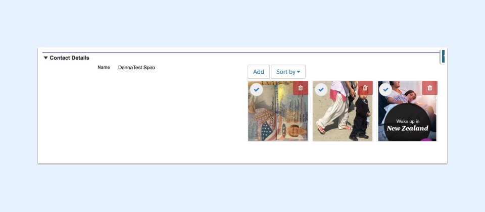

---
layout:
  width: default
  title:
    visible: true
  description:
    visible: true
  tableOfContents:
    visible: true
  outline:
    visible: true
  pagination:
    visible: true
  metadata:
    visible: false
  tags:
    visible: true
  actions:
    visible: true
  anchors:
    visible: true
---

# Basic Setup - Step 3a for Classic Users - Setup SharinPix for Salesforce Classic

Now you are ready to add the SharinPix album to your Page Layout.

The Canvas App is the easiest way to create a space there to add photos, so we'll use that.


**Note:**

* You should keep in mind, though, that these instructions are applicable to the Classic User Interface. Lightning and Mobile User Interfaces will show up with the Canvas App, but need the extra tweaking in the next two articles to work well.
*   Since Canvas apps have some limitations such as limited number of calls within 24-hour, we strongly recommend the usage of the **SharinPix Visualforce Component** over the **SharinPix Canvas App** for implementations. However, the SharinPix Canvas App can still be used for testing purposes.\
    For more information about Canvas app limitations, please refer to the following link:

    [https://developer.salesforce.com/docs/atlas.en-us.platform\_connect.meta/platform\_connect/canvas\_framework\_limits.htm](https://developer.salesforce.com/docs/atlas.en-us.platform_connect.meta/platform_connect/canvas_framework_limits.htm)



## Canvas App - Drag and Drop on the layout

Click EDIT next to the Layout(s) where you want to display photos

 (2).png>)

## Find "Canvas Apps" at the bottom of the list at left in page layout

<figure><figcaption></figcaption></figure>

## Click on Canvas Apps and you'll see Albums in the field box.

Create Section on the page layout, then Save Layout. The Albums won't go into the Albums section until after it has been saved.

 (4).png>)

## Click the wrench on the canvas app to adjust the settings.

* Set the Height to 500 pixels.
* Ok
* Save

 (5).png>)

You can put the Canvas App anywhere on the page. But the best practice is to put all your photos in their own section. Here's how:

1. Add a new section on your layout
2. Use the wrench icon on the section to make it one column
3. Save the layout (not quick saving, use the save button) This step is necessary because if the section isn't saved first, the section won't accept Visual Force or the Canvas App.
4. Re-open the layout
5. Drag and drop the Canvas App into the new section.

## Test by adding a photo!

Drag & Drop or Choose from photo files.

<figure><figcaption></figcaption></figure>


The image above shows a photo in the **Thumbnail View**. For more information about the Thumbnail View and the options it provides, refer to the following article: [Thumbnail View](https://app.gitbook.com/s/5EvYRrLbUyvRh8o1jmMG/features/user-interface/thumbnail-view)


Click to see one photo in full size

## Play with the icons at the top to learn what you can do!

 (4).png>)

## What's next?

The Canvas App works well for Classic. For the best user experience of SharinPix, you'll need to add the SharinPix component to Lightning and the Mobile app.

* Setup[ SharinPix for Lightning Experience](basic-setup-step-3b-for-lightning-users-setup-sharinpix-for-lightning-experience.md)
* Setup [SharinPix for Salesforce mobile App](basic-setup-step-3d-for-old-salesforce-mobile-app-users-setup-sharinpix-for-mobile-classic-implement.md)

If you need even more control over your users' experience, go with the [Visual Force page implementation.](/broken/pages/RGusPjruaQUX3OFeLMVW) No need for a developer, either, to get this done!
