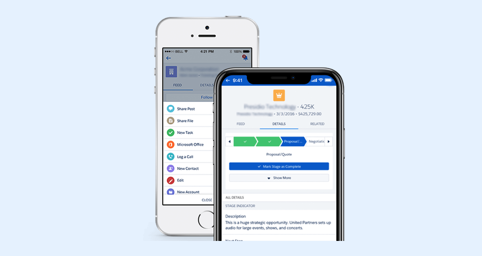

---
layout:
  width: default
  title:
    visible: true
  description:
    visible: true
  tableOfContents:
    visible: true
  outline:
    visible: true
  pagination:
    visible: true
  metadata:
    visible: false
  tags:
    visible: true
  actions:
    visible: true
  anchors:
    visible: true
---

# Basic Setup - Step 3c for new Salesforce Mobile App Users - Setup SharinPix for Mobile (Lightning Experience)

This article demonstrates how to access the **SharinPix Album** component inside the Salesforce mobile app. To do so we will:

1. [Add the SharinPix Album component to an object's record page.](basic-setup-step-3c-for-new-salesforce-mobile-app-users-setup-sharinpix-for-mobile-lightning-experie.md#addition-of-sharinpix-album-component-on-an-objects-record-page)
2. [Access the component inside the Salesforce mobile app.](basic-setup-step-3c-for-new-salesforce-mobile-app-users-setup-sharinpix-for-mobile-lightning-experie.md#access-the-component-inside-the-salesforce-mobile-app)


**Prerequisites:**

The example presented in this article takes place within the new Lightning Experience. In order to proceed, you are therefore required to set up the new Lightning Experience for mobile.

If the new Lightning Experience is not enabled inside your Organisation, here are some useful articles that you can refer to:

* [Lightning Experience for Salesforce Mobile App](https://trailhead.salesforce.com/en/content/learn/modules/lightning-experience-for-salesforce-mobile-app) (introductory articles)
* [Set up the Lightning Experience for Salesforce Mobile App ](https://www.asagarwal.com/lightning-experience-for-salesforce-mobile-app/)(including detailed steps)
* [Set up the Lightning Experience for Salesforce Mobile App](https://admin.salesforce.com/blog/2019/set-up-lightning-experience-on-mobile) (including video)

[Make sure to configure the **Trusted Domains for Inline Frames**](basic-setup-step-3c-for-new-salesforce-mobile-app-users-setup-sharinpix-for-mobile-lightning-experie.md#configure-trusted-domains-for-the-salesforce-mobile-app)


### Configure trusted domains for the Salesforce mobile app 

To allow SharinPix components to load correctly in the Salesforce mobile app, add the SharinPix domain to **Trusted Domains for Inline Frames** in your Salesforce organization.

Salesforce’s additional security measures can prevent embedded SharinPix components from loading when this configuration is missing. Affected users may see a blank area instead of the SharinPix Album/component, even though the component works correctly on the desktop.

#### Add the SharinPix domain 

Ask your Salesforce administrator to complete these steps in the Salesforce organization used by your mobile users:

1. Log in to Salesforce from a desktop browser using an administrator account.
2. Click the **gear icon**, then select **Setup**.
3. In the **Quick Find** box, enter **Session Settings**, then select **Session Settings**.
4. Scroll down to **Trusted Domains for Inline Frames**.
5.  Under **Trusted Domains,** Add the following two entries:

    Domain 1:

    * **Domain:** https://app.sharinpix.com
    * **iFrame Type:** Visualforce Pages

    Domain 2:

    * **Domain:** https://app.sharinpix.com
    * **iFrame Type:** UI Embedding

**Expected result:** Salesforce should now show two trusted-domain entries for `https://app.sharinpix.com` — one for **Visualforce Pages** and one for **UI Embedding**, as shown below:

<figure><figcaption></figcaption></figure>


For additional information, see the FAQ documentation: \
[SharinPix Component displays a blank screen in the Salesforce Mobile App. What should I do?](https://docs.sharinpix.com/faqs/sharinpix-component-displays-a-blank-screen-in-the-salesforce-mobile-app.-what-should-i-do)


## Comparing Lightning Experience and Salesforce Classic

To determine if you are still using the Classic experience for mobile or if you are already using the new mobile Lightning Experience, you should check the following points:

* You are in the mobile Classic Experience if
  * You have rounded colored icons on the bottom when you open a record
  * You have Chatter/Details/Related tabs on the top such as Post, File, New Task, ...
* You are in the new mobile Lightning Experience if
  * You have rounded colored on the top such as Post, File, New Task, ...
  * You have greyed icons on the bottom such as Chatter, Today, Dashboard, and Menu

<figure><figcaption></figcaption></figure>


**Tip:**

One easy way to ensure that the Lightning Experience for mobile has been correctly configured in your organization is to take a look at the layout presented inside the Salesforce mobile app.


The following image depicts how the mobile layout looks like when using the Lightning Experience:

<figure><figcaption></figcaption></figure>

If the layout presented is similar to the one shown in the above image, this is an indication that the Lightning Experience has been correctly configured.

## Addition of SharinPix Album component on an object's record page

In this section we will add the **SharinPix Album** on the page layout of an **Opportunity** object.

To do so, follow the steps below:

* Go to an Opportunity record and edit the page.
* Once inside the **Lightning App Builder**, to preview how the layout will appear inside the Salesforce mobile app, switch from the **Desktop** view to the **Phone** view as shown below:

.png>)

* Open the **Details** tab, then drag and drop the **SharinPix Album** component (found under **Custom - Managed)** on the preview pane as shown below:

 (1).png>)

* Different settings can be applied onto the **SharinPix Album** component. The settings are available on the right panel as shown below:

<figure><figcaption></figcaption></figure>


**Tip:**

For more information on the SharinPix Album's parameters, refer to this article: [SharinPix Album](https://app.gitbook.com/s/5EvYRrLbUyvRh8o1jmMG/lightning-web-component/sharinpix-album)


* Click **Save**.
* Next, click on **Activate**. Here you can assign the Phone Form Factor as the org default, app default or as a combination of apps, record types and profiles.

 (1).png>)

The example below, show a combination of apps, record types and profiles for the Phone Form Factor assignment:

 (1).png>)


**Tip:**

You should ensure that proper assignment is provided to your Phone Phone Factor.


You can now access the **SharinPix Album** component from the Salesforce mobile app.

## Access the component inside the Salesforce mobile app

To access the SharinPix Album component:

* Open the Salesforce mobile app.
* Go to an Opportunity record.
* The SharinPix Album component is available from there.

<figure><figcaption></figcaption></figure>


**Tip:**

If you are using the Classic experience on tablets and iPads, an additional configuration is required for your Organization. Here, you should also enable the **New Salesforce Mobile App for Tablet** on your Org. To do so, follow the steps below:

* From Setup, look for **New Salesforce Mobile App Quickstar**t using the Quick Find search box
* Then, in the **New Salesforce Mobile App for Tablet** section, activate the option **Give All Users Access** as follows:


 (1).png>)


**Note:**

The option to enable the **New Salesforce Mobile App for Tablet** will be available on your Org only if you have **upgraded with the New Salesforce Mobile App QuickStart in Winter '20 Release**.

If you did not opt-in for this feature during Winter' 20 but, still want to access the Toggle for **New Salesforce Mobile App for Tablet** in the Setup section for **New Salesforce Mobile App Quickstart**, kindly create a case to request Salesforce Support to enable it on your Org.

Click on the following link for more details on the above:

[https://help.salesforce.com/articleView?id=000352373\&language=en\_US\&mode=1\&type=1](https://help.salesforce.com/articleView?id=000352373\&language=en_US\&mode=1\&type=1)


## What's Next?


Now it's time to check out the features you can enable from [SharinPix Global Settings](../advanced-configuration-customizing-your-sharinpix-components-with-sharinpix-permissions.md)

