# FieldKnot setup guide

FieldKnot is a Microsoft Power Platform solution for Dynamics 365 Field Service, available on the Microsoft Marketplace. Contractors use it to assign jobs to their workers, while SharinPix handles photo capture and forms in the field.

Before FieldKnot can be used, it has to be connected to SharinPix with a **SharinPix Secret URL**. This guide covers that one-time setup, then explains how to manage workers and jobs in FieldKnot and how field workers complete their jobs in the SharinPix mobile app.

## Before you begin

Make sure that:

* The FieldKnot solution is installed from the Microsoft Marketplace in your Microsoft Dynamics 365 organization.
* You have access to the **FieldKnot Setting** app in that organization.
* Your field workers have the SharinPix mobile app on their smartphones. See [Install the SharinPix mobile app](./#install-the-sharinpix-mobile-app).

## Connect FieldKnot to SharinPix

### Step 1: Request your SharinPix Secret URL

Email [info@sharinpix.com](mailto:info@sharinpix.com) to say that you have installed the FieldKnot solution in your Microsoft Dynamics 365 organization. SharinPix will reply with your Secret URL.


Treat the Secret URL like a password. Don't share it outside your IT or admin team.


### Step 2: Enter the Secret URL in FieldKnot Setting

1. In Dynamics 365, open the **App Launcher** (the grid icon in the top-left corner).
2.  Select **FieldKnot Setting**.

    <figure>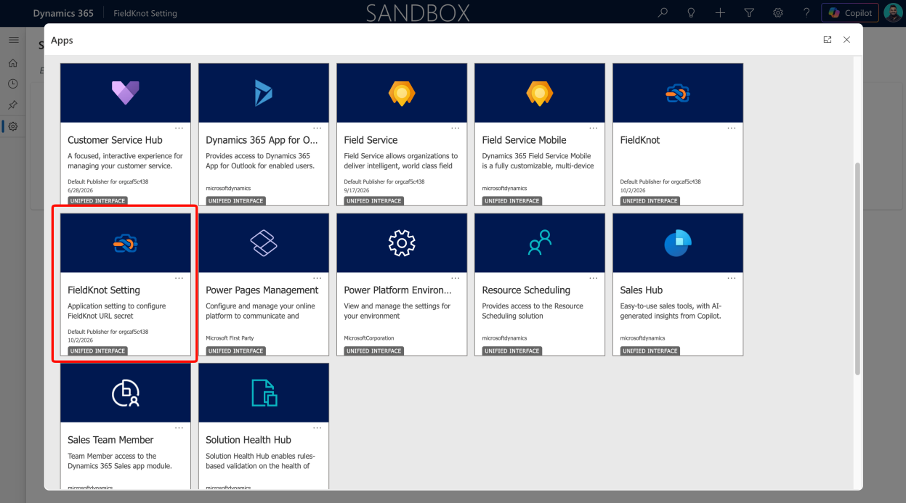<figcaption></figcaption></figure>
3. In the left navigation, under **Setting**, select **Secret URL Setting**.
4. Paste the Secret URL from SharinPix into the text box.
5. Select **Save**. The status next to **SharinPix Secret URL** changes to **Configured**.

<figure>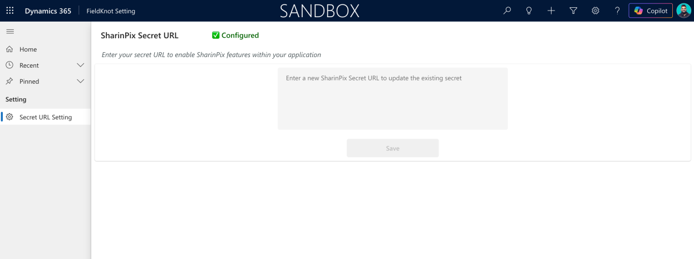<figcaption></figcaption></figure>

To replace the Secret URL later, for example if SharinPix issues you a new one, return to this page, paste the new URL and select **Save**. The new URL overwrites the existing secret.

### Step 3: Open the FieldKnot app

1. Open the **App Launcher**.
2. Select **FieldKnot**.

<figure>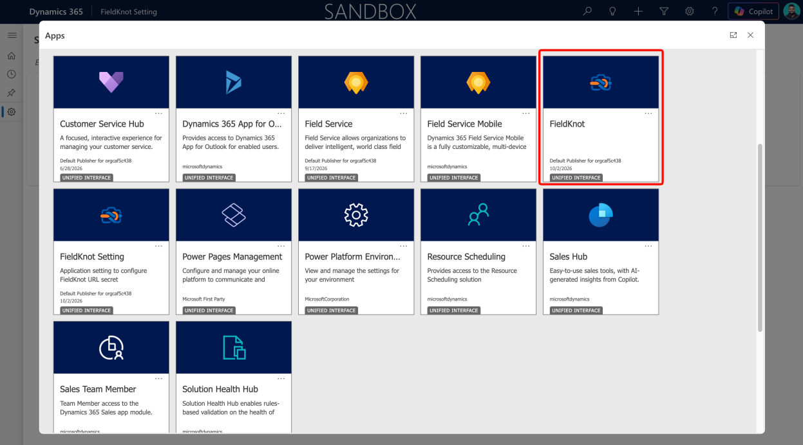<figcaption></figcaption></figure>

The app opens with **Workers** and **Jobs** in the left navigation.

## Manage workers

Workers are the people who carry out jobs in the field. The **Workers** page lists all active workers with their SharinPix Worker Name, linked Contact and Owner.

<figure>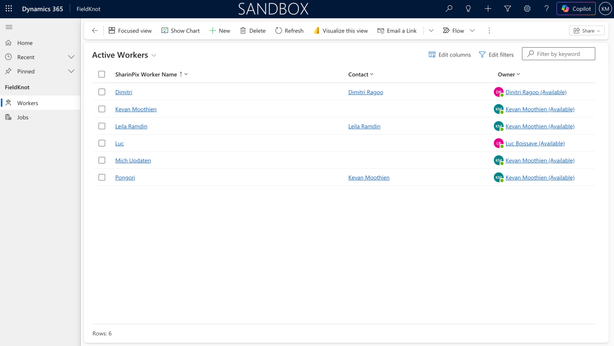<figcaption></figcaption></figure>

### Create a worker

1. In the left navigation, select **Workers**.
2. Select **New**.
3. Enter the **SharinPix Worker Name** (required).
4. Optionally, select a **Contact** to link the worker to an existing Dynamics 365 contact.
5. Check that **Owner** is set, then select **Save**.

Once saved, the worker record also shows:

* **Link**: the worker's personal SharinPix link, which opens the SharinPix app with that worker's jobs.
* **UUID**: a read-only identifier for the worker in SharinPix.


The worker link contains an access token. Share it only with the worker it belongs to.


### Assign jobs to a worker

A worker can have several jobs. In the **Active Jobs** section of the worker record, select **New Job** to create a job for that worker, or **Add Existing Job** to assign a job that already exists.

<figure>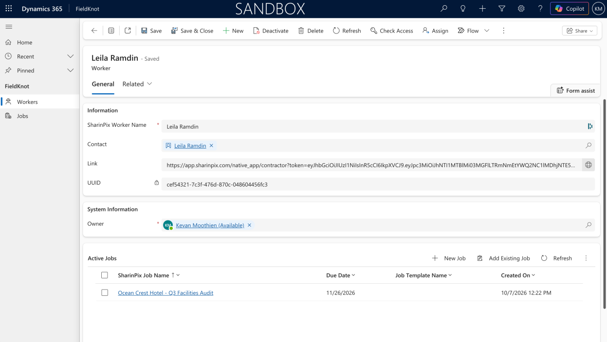<figcaption></figcaption></figure>

## Manage jobs

The **Jobs** page lists all active jobs with their SharinPix Job Name, Due Date, Job Template Name and Created On date. To create a job, select **Jobs** in the left navigation, then select **New**.

<figure>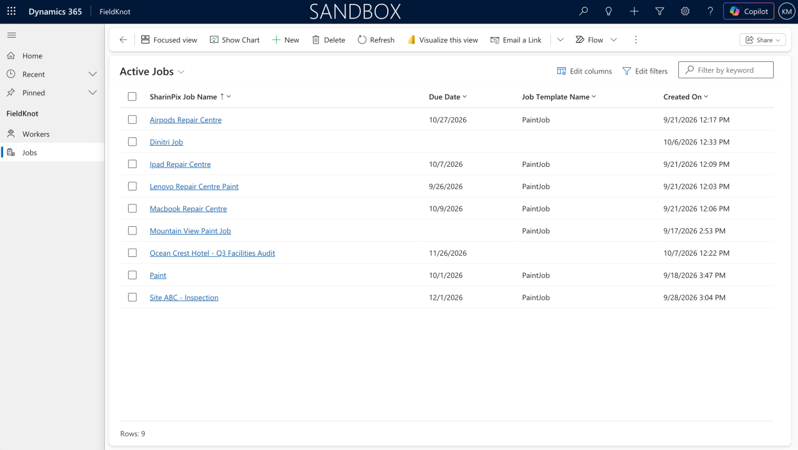<figcaption></figcaption></figure>

### View a job record

Open a job from the **Jobs** page or from the **Active Jobs** section of a worker record. The **General** tab has two areas:

* **Job details** (left): SharinPix Job Name (required), Description, Due Date, SharinPix Worker (the worker assigned to the job) and Job Template Name.
* **SharinPix panel** (right): the job name and due date, plus a **Line Items** tab and an **Activity** tab. The Line Items tab lists each line item with its status, such as _Not Started_ or _In Progress_. Use the search box to find a specific line item.

<figure>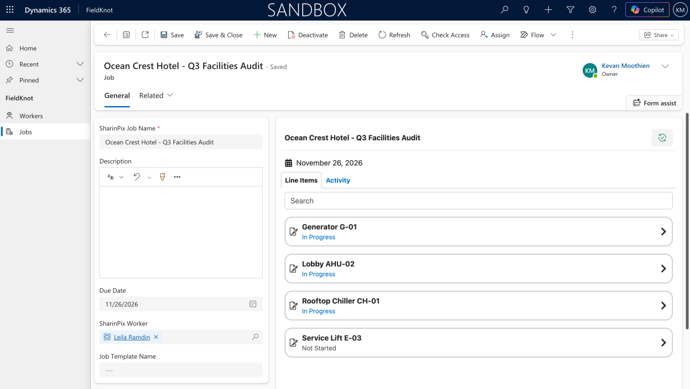<figcaption></figcaption></figure>

### View job line items

Line items are the individual items that make up a job, such as pieces of equipment to inspect. To see them, open the **Job Line Items** tab on the job record. The list shows each line item's Name and Created On date.

Select **New Job Line Item** to create one, or **Add Existing Job Line Item** to add one that already exists.

<figure>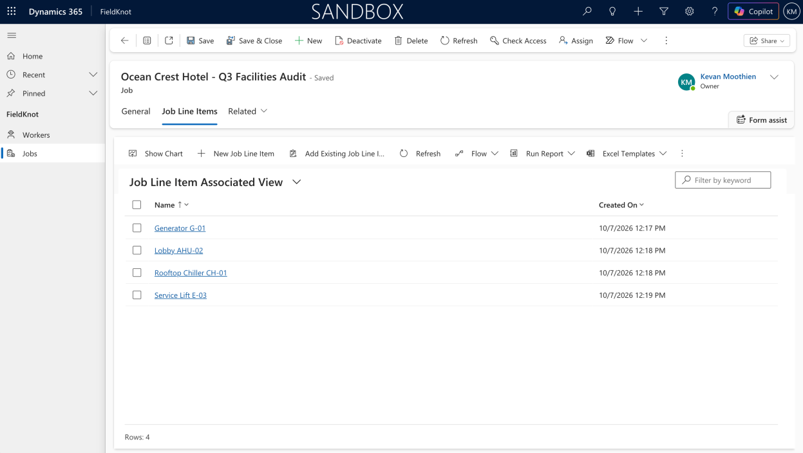<figcaption></figcaption></figure>

## Install the SharinPix mobile app

Each worker needs the SharinPix mobile app on their smartphone. They use it to open their assigned jobs and capture photos, and everything they record is synced back to Dynamics 365. Without the app, workers can't open their personal SharinPix link or complete jobs in the field.

Ask each worker to download the free app for their device:

* **Android (Google Play):** [SharinPix on Google Play](https://play.google.com/store/apps/details?id=com.sharinpix.SharinPix\&hl=en)
* **iPhone (App Store):** [SharinPix on the App Store](https://apps.apple.com/us/app/sharinpix/id1199668730)

After installing the app, the worker opens the personal SharinPix link from their worker record (see [Create a worker](./#create-a-worker)). The link opens the app with that worker's jobs.

## Complete jobs in the SharinPix mobile app

Field workers carry out their jobs in the SharinPix mobile app. When a worker opens their personal link, the app shows the FieldKnot workspace with every job assigned to them. Everything they record, including forms, photos and comments, is synced back to the job in Dynamics 365.

### Open a job

The home screen lists the worker's assigned jobs. Use the search box to find a job, and tap the sync icon at the top to refresh the list. Tap a job to open it. Each job shows its due date and two tabs:

* **Line Items**: the items to complete for the job, each with its status (for example, _Not Started_ or _In Progress_).
* **Activity**: a history of everything recorded on the job, such as completed forms, comments and photos.

<figure>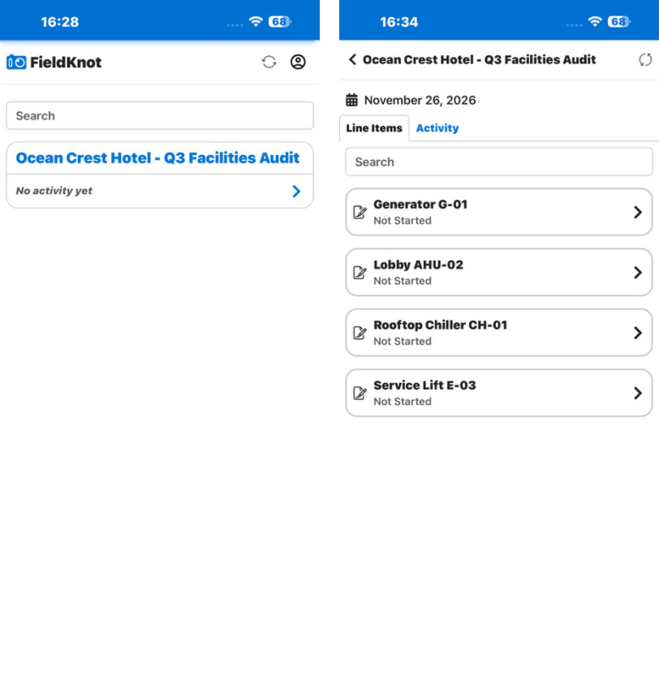<figcaption></figcaption></figure>

### Complete an inspection form

Tap a line item to open its form. Each line item has its own form, for example an HVAC Asset Inspection for an air handling unit or a Lift Safety Inspection for a lift.

1. Fill in the fields. Fields marked with a red asterisk (\*) are required. Tap **Now** to fill in the current date and time.
2. Go to the **Verdict** page and choose the inspection verdict. If the verdict is _Conditional_, describe the required corrective action.
3. Sign in the **Inspector signature** box, then tap **Submit**.
4. In the **Confirm Submission** message, tap **Submit**.

<figure>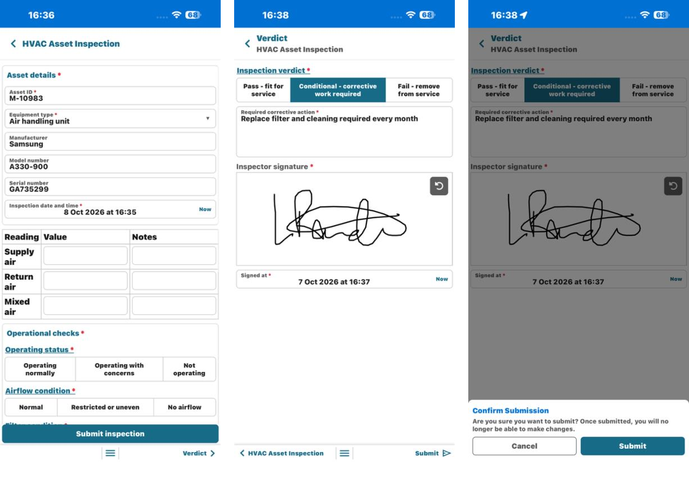<figcaption></figcaption></figure>


Once a form is submitted, it can no longer be changed.


### Capture photos

Some forms ask for photo evidence, such as the **Cabin photos** field in the Lift Safety Inspection form.

1. Tap the photo field to open the SharinPix camera.
2. Take one or more photos.
3. Tap the green check mark to return to the form.

The photos appear as thumbnails in the form. To remove one, tap the red bin icon on its thumbnail.

Workers can also use the **Comment** and **Capture** buttons on a job's **Activity** tab to add comments and photos directly to the job.

<figure>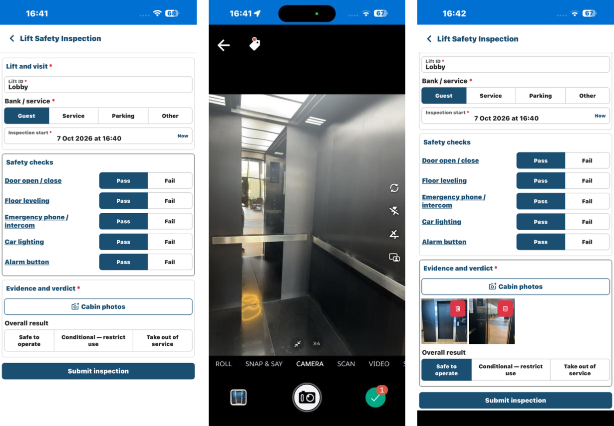<figcaption></figcaption></figure>

### Track progress

When a worker submits a form, the line item's status changes from _Not Started_ to _In Progress_, and the form is added to the job's **Activity** tab. Tap **View response** to open a read-only copy of the submitted form, with the date and time it was submitted.

The same line item statuses appear in the SharinPix panel of the job record in Dynamics 365.

<figure>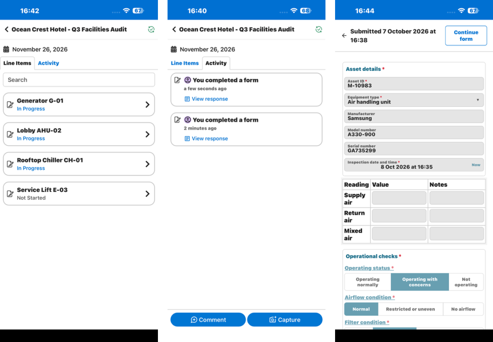<figcaption></figcaption></figure>

## Get support

If you need help setting up or using FieldKnot or the SharinPix mobile app, email [support@sharinpix.com](mailto:support@sharinpix.com). To help the team respond quickly, include your organization name, a short description of the issue and any relevant screenshots.
